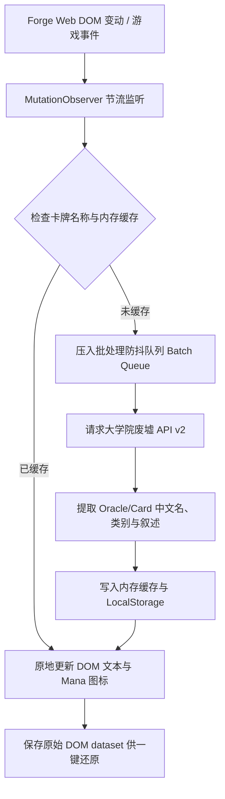

# Forge Web 卡牌汉化 (Forge Web MTG Chinese Localization)

专为万智牌网页对战平台 [Forge Web (forgeweb.app)](https://forgeweb.app/) 打造的原地卡牌汉化油猴脚本（Tampermonkey / Violentmonkey / ScriptCat）。

参考了社区优秀的 [Scryfall 卡牌汉化脚本](https://greasyfork.org/zh-CN/scripts/508932-scryfall%E5%8D%A1%E7%89%8C%E6%B1%89%E5%8C%96) 设计思想，结合 Forge Web 基于文本与 HTML/CSS 渲染卡牌的特点，实现卡牌**全场景原地实时汉化**。

汉化数据源自国内权威万智牌卡查平台——**大学院废墟 (mtgch.com)**，包含官方简中译名、Oracle 规则叙述以及未发行简中牌的社区高质量译文。

---

## ✨ 核心特性

1. **全场景原地汉化**：
   - **战场地砖 (Battlefield Tiles)**：卡牌名称、类别与攻防指示直接汉化显示。
   - **手牌与堆叠 (Hand & Stack)**：完整卡牌框体、卡牌名称、类别栏（保留原版系列图标）、规则叙述文本全部汉化。
   - **卡牌详情检查抽屉 (Inspection Drawer)**：右侧/弹出层大图预览中的卡牌文本实时汉化。
   - **套牌库与构筑器 (Decks & Editor)**：套牌列表、卡牌数量条目、导入解析对话框卡牌名称原地翻译。
   - **特殊牌张结构支持**：完美支持传纪（Saga 提示文本与各章节效果）、鹏洛客（忠诚异能分项匹配）、历险牌/双面牌/房间牌（Room 分面与大门效果）。
2. **悬浮异能机制说明框汉化 (Card Mechanics & Keywords)**：
   - 鼠标悬浮或检查卡牌时，弹出层下方显示的关键词异能说明小框（如飞行、践踏、守护、变身、死触、系命、占卜、刺探等）及其官方规则提示文本（Reminder Text）全量原地汉化为官方标准中文。
   - 完美支持带费用与数值参数的动态异能（如 `守护 {2}`、`占卜 2`、`搭载 3`、`备鞍 2`、`毒性 1` 等）。
3. **原生法术力符号渲染**：
   - 自动将 `{T}`、`{W}`、`{U}`、`{B}`、`{R}`、`{G}`、`{1}`、`{2}`、`{X}`、杂合法术力 `{W/U}`、非瑞人法术力 `{W/P}` 以及早期规则文本的 `oT`、`o2` 等规范化转换为 Forge Web 内置的 Mana Font 图标，排版无缝契合原版 UI。
4. **极速性能与多级缓存**：
   - 内置基本地与常见指示物零延迟直接翻译。
   - **内存 + 本地持久化缓存 (localStorage / GM_setValue)**：已查询过的卡牌永久秒开，不重复消耗流量。
   - **智能并发批处理 (Batch Queue)**：多张新卡牌同时入场时自动合并查询（`!"Card1" or !"Card2"`），最大化降低网络请求。
4. **一键双语切换与悬浮控制面板**：
   - 右下角提供半透明极简控制悬浮球 `[文 中]`，点击即可展开控制面板。
   - 支持**一键开启/暂停汉化**（即刻原样还原英文）。
   - 支持**双语对照模式**（如：`闪电击 (Lightning Bolt)`）。
   - 支持**游戏阶段与区域汉化**（牌库、坟墓场、放逐区、战斗阶段、行动阶段等）。
5. **快捷卡查联动**：
   - 按住 `Alt` 键点击战场、手牌或堆叠上的任意卡牌，直接在“大学院废墟”中打开该牌的官方裁定、各版本原画与价格数据。

---

## 🚀 安装与使用

### 第一步：安装用户脚本管理器
如果你的浏览器尚未安装脚本管理器，请先安装以下任一扩展：
- [Tampermonkey (篡改猴)](https://www.tampermonkey.net/)（推荐 Chrome / Edge / Firefox / Safari）
- [Violentmonkey (暴力猴)](https://violentmonkey.github.io/)
- [ScriptCat (脚本猫)](https://scriptcat.org/)

### 第二步：安装本脚本
- **官方 Greasy Fork 一键安装**：直接访问 [Greasy Fork 脚本主页](https://greasyfork.org/zh-CN/scripts/600077-forge-web-%E5%8D%A1%E7%89%8C%E6%B1%89%E5%8C%96-forge-web-mtg-chinese-localization)，点击绿色的 **「安装此脚本」** 即可。
- **手动安装**：将本仓库下的 [`forgeweb-chinese.user.js`](file:///Users/Zhuanz/Documents/antigravity/forgewebcn/forgeweb-chinese.user.js) 源码复制粘贴到脚本管理器中保存。
- 安装完成后打开或刷新 [https://forgeweb.app/](https://forgeweb.app/)，即可体验流畅纯正的中文卡牌对战！

---

## 🎮 控制面板与快捷键

| 功能 / 快捷键 | 说明 |
| :--- | :--- |
| **右下角悬浮球 `[文 中]`** | 点击展开/收起汉化控制面板 |
| **卡牌汉化开关** | 快速切换中文与原版英文 |
| **双语牌名对照** | 开启后牌名显示为 `中文名 (English Name)` |
| **阶段与区域汉化** | 汉化阶段轨（开始/第一行动/战斗/第二行动/结束）和区域标签（牌库/坟场/放逐区） |
| **Alt + 鼠标点击卡牌** | 直接在新标签页打开大学院废墟 (mtgch.com) 查阅此卡与规则判例 |
| **清空缓存** | 清理本地存储的卡牌翻译缓存并重新拉取 |

---

## 🛠️ 技术原理与架构

- **React-Safe 虚拟 DOM 零冲突架构**：深度适配 Forge Web 基于 React 18 的运行机制。采用文本节点直接更新 (`nodeValue`) + 规则叙述非破坏性安全覆层 (`Sibling Overlay`) 机制，彻底保留 React Fiber 原生 DOM 树结构，杜绝卡牌移动/卸载时的 `DOMException: Node was not found`，杜绝任何黑屏崩溃。
- **DOM 准确定位**：精准匹配 Forge Web 的 React CSS Modules，捕获 `_card_jzxwn`（大卡/手牌）、`_tile_y09se`（战场地砖）、`_sectionList_jzxwn`（传纪/鹏洛客异能）及套牌列表元素，并自动跳过内部引擎追踪层（`[aria-hidden="true"]`）。
- **无损切换与安全还原**：将原文存入 `dataset.origText`，随时支持在中文与原版英文之间毫秒级平滑切换。
- **CORS 与跨域兼容**：利用 `GM_xmlhttpRequest` 原生跨域能力，在纯浏览器环境也能直接访问 mtgch OpenAPI。
